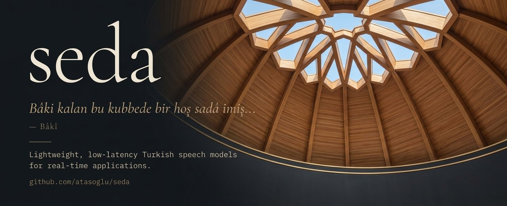

[](https://pypi.org/project/sedalib/)
[](https://www.python.org/)
[](LICENSE)
[](https://github.com/k2-fsa/sherpa-onnx)
[](https://huggingface.co/atasoglu/seda-v0.2)
[](https://github.com/astral-sh/ruff)
[](https://github.com/astral-sh/uv)

Lightweight, low-latency Turkish speech models for real-time applications.

Seda aims to provide models that are small enough to run on a CPU, fast enough for live audio, accurate enough for production, and available for commercial use. `sedalib` is the Python package for running them. It ships streaming speech recognition (STT) on top of [sherpa-onnx](https://github.com/k2-fsa/sherpa-onnx) and speech synthesis (TTS) with onnxruntime.

## Models

| Model | Task | Architecture | Params | FLEURS-TR test WER |
| --- | --- | --- | --- | --- |
| [seda-v0.2](https://huggingface.co/atasoglu/seda-v0.2) | Streaming STT | Zipformer2 transducer + second pass | 66.1M | 6.38 (`accurate`), 7.26 (`balanced`) |
| [seda-v0.2-tiny](https://huggingface.co/atasoglu/seda-v0.2-tiny) | Streaming STT | Zipformer2 transducer + second pass | 4.5M | 10.51 (`accurate`), 11.24 (`balanced`) |
| [seda-v0.1](https://huggingface.co/atasoglu/seda-v0.1) | Streaming STT | Zipformer2 transducer | 66.1M | 11.60 |
| [seda-tts-v0.1](https://huggingface.co/atasoglu/seda-tts-v0.1) | TTS | VITS + BERT | 19.1M + 29.3M | – |

For comparison, Whisper small scores 11.87, Whisper medium 6.62 and Whisper large-v3 4.62 on the same set. See the [seda-v0.2 card](https://huggingface.co/atasoglu/seda-v0.2) for noisy, telephone and broadcast audio. seda-v0.2-tiny is distilled from seda-v0.2 for slow CPUs, phones and the browser: its acoustic model is 7 MB, and it runs every mode with the same options (`Recognizer.from_pretrained("atasoglu/seda-v0.2-tiny")`).

seda-tts-v0.1 speaks Turkish in one synthetic voice, normally (8 emotions) or in a whisper (4). It starts speaking 80–150 ms after it gets the text and runs about 4.5× faster than real time on one CPU thread. See [Speech synthesis](#speech-synthesis) and the [model card](https://huggingface.co/atasoglu/seda-tts-v0.1) for samples.

## Installation

```bash
pip install sedalib
pip install "sedalib[format]"  # adds digits, punctuation and casing to the output
```

Python 3.10 or newer is required. The core package depends only on `sherpa-onnx` and `huggingface-hub`.

## Quick start

Transcribe a complete waveform. `read_wav` loads a 16-bit PCM WAV file as mono float samples in [-1, 1] together with its sample rate:

```python
from sedalib import Recognizer, read_wav

samples, sample_rate = read_wav("audio.wav")

recognizer = Recognizer.from_pretrained()  # downloads the model once and caches it
text = recognizer.transcribe(samples, sample_rate)
print(text)
```

Audio at other sample rates is resampled automatically.

## Streaming

For live audio, open a stream and feed it small pieces as they arrive. `accept` returns the current partial transcript, and `is_endpoint` turns true when the speaker pauses. `end_utterance` returns the final text and starts the next utterance.

```python
stream = recognizer.stream()

for chunk in microphone_chunks():  # e.g. 100 ms of audio at a time
    partial = stream.accept(chunk, sample_rate=16000)
    print(partial)

    if stream.is_endpoint:
        print("final:", stream.end_utterance())
```

The end of speech is detected by Silero VAD after a 0.75 s pause (`endpoint_silence`). A shorter pause gives the final text sooner but splits slow speech; a `Stream` can change it while it runs, e.g. `stream.endpoint_silence = 0.3`. If your application already knows that the speaker stopped, for example with a push-to-talk button, call `end_utterance()` right away.

To keep accepting audio while the final text is computed, split the two steps: `stream.cut()` ends the utterance and returns it, and `utterance.finalize()` can run in another thread.

A single `Recognizer` can serve many streams at once, from different threads. Call `stream.finish()` at the end of the audio to flush the remaining frames and get the final text.

## Keywords

`KeywordSpotter` finds words or phrases in a file or a live stream, with the time and a confidence for each:

```python
from sedalib import KeywordSpotter

spotter = KeywordSpotter(recognizer, ["deneme", "bir", "iki", "üç"], min_confidence=0.5)

for d in spotter.find(samples, sample_rate):
    print(
        d.keyword, d.text, d.start, d.end, d.confidence
    )  # keyword, what was heard, seconds

stream = spotter.stream()
for chunk in microphone_chunks():
    for d in stream.accept(chunk, sample_rate=16000):  # at the end of each utterance
        print(d.keyword, d.start)
```

- **Matching:** on the final spoken-form words, as the model writes them ("Ankara'da" is "ankarada", numbers are words). The last word may carry Turkish suffixes, so "kamp" also finds "kampa" and "kampın" but not "kampanya". Stem changes are not covered: list "kitabı" too if "kitap" should find it. Short keywords can match other words this way ("at" finds "ata"); `suffixes=False` matches whole words only.
- **Confidence:** the probability that the words were recognized right, calibrated on held-out speech for seda-v0.2 and seda-v0.2-tiny: the `fast`, `balanced` and `accurate` modes, and `chunk=8` or `16` with or without `use_lm`. On FLEURS-TR test, transcribed one sentence at a time, it is off by about 2 points on average. Other setups and models give `None`, and `min_confidence` then keeps every match.
- **Latency:** a live detection arrives when the utterance ends, after the VAD's pause.

Every word of a transcript is available too: `recognizer.transcribe_words(samples, sample_rate)` and `utterance.words` return `Word(text, start, end, score, confidence)`.

## Modes

| Mode | Live text | Final text | WER | Final text after a pause | RTF |
| --- | --- | --- | --- | --- | --- |
| `fast` | 0.64 s chunks, greedy | the same | 9.38 | 0.32 s | 0.042 |
| `balanced` (default) | 1.28 s chunks, beam search + LM | the same | 7.26 | 0.37 s | 0.064 |
| `accurate` | 0.64 s chunks, greedy | second pass with full context, beam search + LM | 6.38 | 0.77 s | 0.137 |

- **WER:** FLEURS-TR test.
- **Final text after a pause:** median time from the end of speech, including the pause the VAD waits for: measured with `endpoint_silence=0.25` (the default pause is 0.75 s).
- **Speed:** RTF on one thread of an Intel Core 5 210H CPU, including the second pass.

The second pass of `accurate` runs in the background while the utterance is spoken, so most of its work is done when the speaker stops.

## Options

```python
Recognizer.from_pretrained(
    "atasoglu/seda-v0.2",  # Hugging Face repo id
    revision=None,  # pin a branch, tag or commit
    mode="balanced",  # "fast", "balanced" or "accurate"
    use_lm=None,  # override the mode: rescore with the language model
    two_pass=None,  # override the mode: decode each utterance again for the final text
    chunk=None,  # override the mode: 8, 16, 32 or 64 frames (0.16 to 1.28 s per streaming step)
    punctuate=False,  # digits, punctuation, casing and apostrophes in final texts (needs [format])
    num_threads=1,  # CPU threads per model
    vad=None,  # Silero VAD for the end of speech (default: if the model ships it)
    endpoint_silence=None,  # pause that ends an utterance, in s (default 0.75 with the VAD, 1.2 without)
)
```

`from_pretrained` downloads only the files the chosen options need. To load a model you have already downloaded, use `Recognizer("path/to/model_dir")`.

- **Faster end of speech:** a shorter pause gives the final text sooner, but splits sentences more often at short hesitations. With 0.15 s, the final text arrives after about 0.22 s (`fast`) and 0.27 s (`balanced`).
- **Threads:** `num_threads=2` makes `fast` and `balanced` about 15% faster. More threads do not help a single stream. To serve many users, give each stream one thread and run them in parallel: one recognizer scales to about 4× the throughput on 8 cores.
- **Formatter:** `punctuate=True` writes "Bugün Ankara'da hava 24 derece" instead of "bugün ankarada hava yirmi dört derece". `sedalib.itn` converts only the numbers and needs no extra.
- **Short chunks:** `chunk=8` or `16` react sooner (0.16 or 0.32 s steps) but cost more CPU per second of audio and are a little less accurate. On slow devices, prefer `chunk=16` with greedy search or the default 0.64 s.
- **seda-v0.1:** works with the `balanced` mode, with or without `use_lm`, and ends utterances with the 1.2 s silence rule. It does not have the files for `fast`, `accurate`, the short chunks, the VAD or the formatter.

## Speech synthesis

A seda VITS model (BERT text encoder, onnxruntime, no PyTorch) turns Turkish text into speech. Numbers, dates, currency and abbreviations are first written out in words with [normalizer-tr](https://pypi.org/project/normalizer-tr/) (Python 3.11 or newer; on 3.10 use `expand=False`).

```bash
pip install "sedalib[tts]"
```

```python
from sedalib import Synthesizer, write_wav

tts = Synthesizer.from_pretrained()  # atasoglu/seda-tts-v0.1, cached
wav = tts.synthesize("Bugün hava 24 derece.")
write_wav("out.wav", wav, tts.sample_rate)

# float32 chunks, play while the rest is decoded
for chunk in tts.stream("Merhaba, nasılsın?"):
    ...
```

`speaker`, `emotion`, `style`, `noise_scale`, `noise_scale_w` and `length_scale` change the voice. `Synthesizer("path/to/model_dir")` loads a local model. A model offers only the voices and styles it does well (`tts.speakers`, `tts.styles`); each style has its own emotions and settings (`tts.emotions_for(style)`, `tts.defaults_for(style)`), which are used unless you pass your own. Short sentences are read together, up to 120 characters, so the model pauses between them as in its training data. The voices are synthetic: label the audio as AI-generated, and credit [Ahenk TTS](https://huggingface.co/ozgurguler/ahenk-tts-tr) (CC BY 4.0), which made the training speech.

## Demo

A Gradio demo with live microphone streaming, file transcription, a control panel for all options and latency stats is available as an extra:

```bash
pip install "sedalib[demo,tts]"
python -m sedalib.demo.stt
python -m sedalib.demo.keywords  # keyword spotting: type keywords, speak, see matches with confidence
python -m sedalib.demo.tts  # speech synthesis; SEDA_TTS_MODEL=dir or repo id for another model
```

## Development

```bash
uv sync --all-extras
uv run prek install  # ruff lint and format hooks
uv run pytest  # tests that need a model are skipped
SEDA_TEST_MODEL=atasoglu/seda-v0.2,atasoglu/seda-v0.2-tiny,atasoglu/seda-v0.1 uv run pytest  # with models
SEDA_TEST_TTS_MODEL=atasoglu/seda-tts-v0.1 uv run pytest tests/test_synthesizer.py  # speech synthesis
```

## License

The code is released under Apache-2.0. The seda-v0.2 and seda-v0.2-tiny model files are CC BY-SA 4.0, because parts of their training data are share-alike: Khan Academy for the acoustic model, and Wikipedia for the language model and the formatter. The Silero VAD file shipped with the model is MIT. seda-tts-v0.1 is Apache-2.0; its BERT is MIT, and its training speech was made with Ahenk TTS (CC BY 4.0), which must be credited. Commercial use is allowed under these terms; see the model cards for details.
